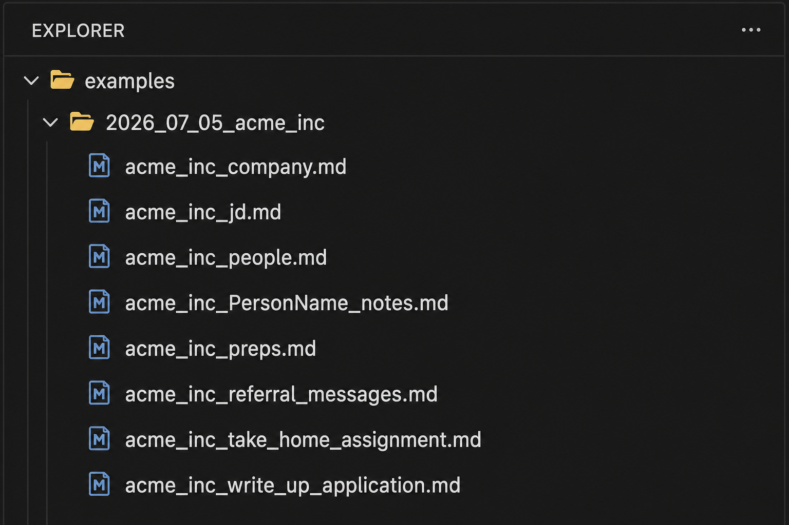
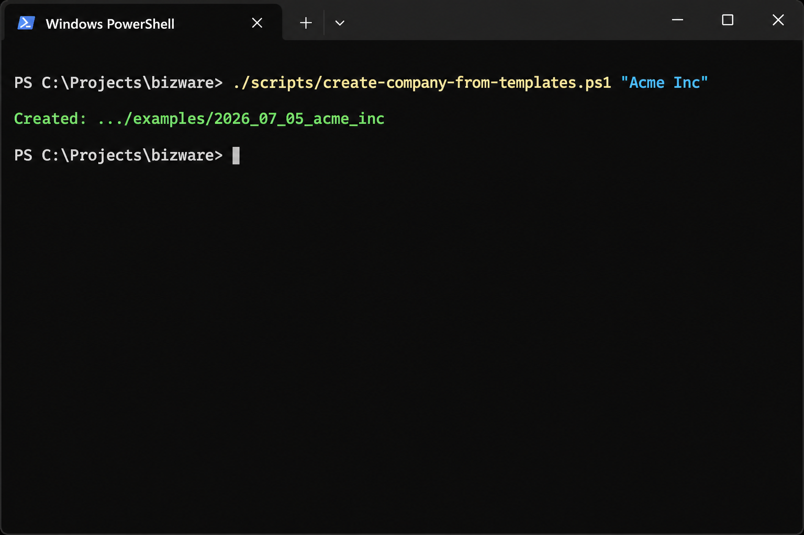
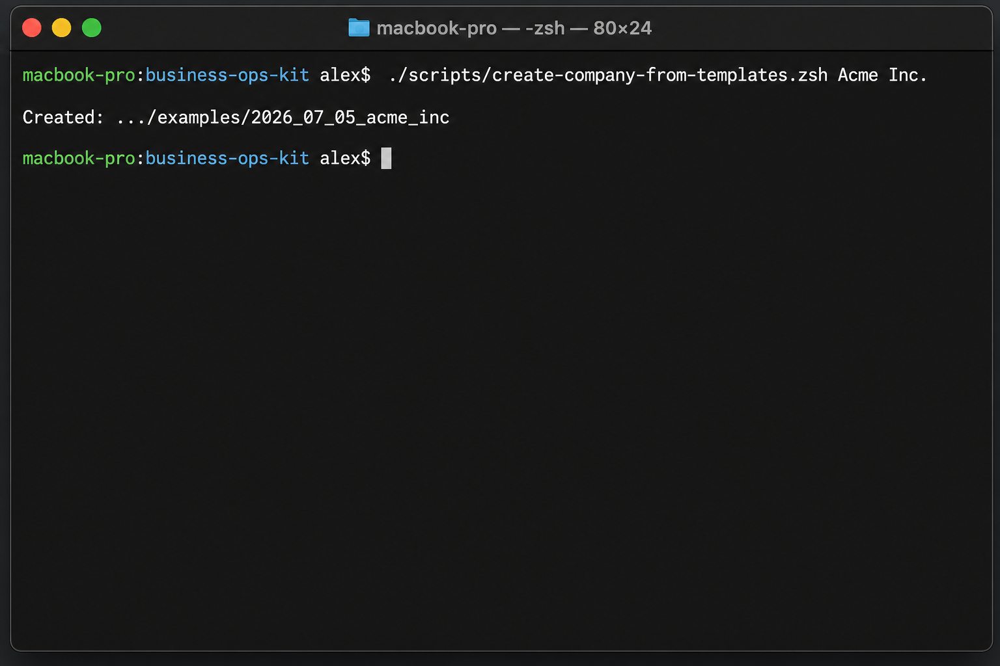

# PM Job Search Templates

## Problem

Interview preparation fragments across job descriptions, company research, interviewer notes, referrals, and take-homes.

## What this toolkit does

These Markdown templates and scaffold scripts create one dated, consistently named folder per Product Manager opportunity. They work with [Cursor](https://cursor.com) or any AI assistant that can follow structured notes.

## Public-safe scope

The repository contains reusable templates and a fictional Acme demo only. Your generated `companies/` folders are gitignored, so personal job-search notes, employer information, and contacts are not part of this public repository.

## How it works

## Quick start

```powershell
git clone https://github.com/harshalnpatil/pm-job-search-templates.git
cd pm-job-search-templates
./scripts/create-company-from-templates.ps1 "Acme Inc"
```

```zsh
git clone https://github.com/harshalnpatil/pm-job-search-templates.git
cd pm-job-search-templates
chmod +x scripts/create-company-from-templates.zsh
./scripts/create-company-from-templates.zsh Acme Inc
```

The script creates `companies/YYYY_MM_DD_<slug>/`, copies Markdown templates, and renames `CompanyName_*` files to your company slug.



*Generated folder structure for the fictional `Acme Inc` example. Real generated folders stay local and gitignored.*

Custom output location:

```powershell
./scripts/create-company-from-templates.ps1 -OutputRoot "C:\path\to\your\companies" "Acme Inc"
```

```zsh
./scripts/create-company-from-templates.zsh --output-root ~/job-search/companies Acme Inc
```

See a committed demo output in [`examples/2026_07_05_acme_inc/`](examples/2026_07_05_acme_inc/).

## Repo layout

```text
pm-job-search-templates/
├── README.md
├── LICENSE
├── scripts/
│   ├── create-company-from-templates.ps1
│   └── create-company-from-templates.zsh
├── templates/
│   └── CompanyName_*.md
├── docs/
│   ├── person_notes_convention.md
│   └── images/
├── examples/
│   └── 2026_07_05_acme_inc/
└── companies/          # gitignored; your generated folders
```

## Template guide

| File | When to use it |
|------|----------------|
| `{slug}_jd.md` | Structured JD analysis: scope, skills, gaps. Input layer, not polished interview answers. |
| `{slug}_company.md` | Company and product research tied to the JD surface area. |
| `{slug}_preps.md` | Interview emphasis, concerns, FAQs, intro pitch, why company/role/now. |
| `{slug}_PersonName_notes.md` | Per-interviewer prep plus post-call notes in one file. |
| `{slug}_people.md` | Lightweight index of person-level files. |
| `{slug}_referral_messages.md` | Referral and intro drafts (LinkedIn, email, forwardable note). |
| `{slug}_write_up_application.md` | Application narrative aligned with JD and prep. |
| `{slug}_take_home_assignment.md` | Take-home case structure (9 steps: problem through risks). |

## Cursor / AI tips

- `> Agent note:` blockquotes in templates are intentional. They tell the assistant what belongs in each section.
- When a section is filled with real content, strip the blockquote for that section. Do not re-add blockquotes to existing files.
- Person notes follow a single-file model: keep full `## preps` after the call; capture what was said under `## Notes in call`.
- Full rules: [`docs/person_notes_convention.md`](docs/person_notes_convention.md)

## Visual evidence

PowerShell example on Windows, using fictional `Acme Inc` input:



zsh example on macOS or Linux, using fictional `Acme Inc` input:



## Attribution

Created by [Harshal Patil](https://www.harshal-patil.com).

- Website: [harshal-patil.com](https://www.harshal-patil.com)
- LinkedIn: [linkedin.com/in/harshalnpatil](https://www.linkedin.com/in/harshalnpatil)

## License

MIT. See [LICENSE](LICENSE).
